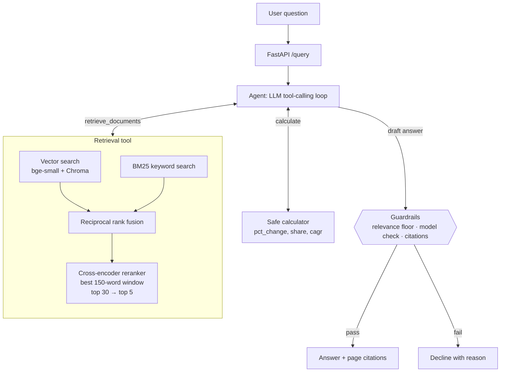

# Consulting Research Copilot

[](https://github.com/Ohm-Kel/consulting-research-copilot/actions/workflows/ci.yml)


Question answering over five companies' annual reports, with page-level citations, a
calculator-equipped agent that declines when the reports are silent, and an evaluation that CI
re-runs on every change.

## Demo

```
Q: How did Nike's gross margin change in fiscal 2025, and what did management say caused it?

Answer: Nike's consolidated gross margin declined 190 basis points, from 44.6% in fiscal 2024 to
42.7% in fiscal 2025. Gross profit fell 14% to $19,790 million. [1][2]
Management attributed the decline primarily to lower NIKE Brand average selling prices (about
180 bps), driven by higher discounts and channel-mix changes... partly offset by lower product
costs (~80 bps) and lower warehousing and logistics costs (~20 bps). [1]

Sources: [1] Nike_FY2025_10K.pdf, p. 38  [2] Nike_FY2025_10K.pdf, p. 35
```

*Real output from `gpt-5.6-terra`, checked against the 10-K. More in [docs/examples.md](docs/examples.md).
Run it locally and open http://localhost:8000/ to try both search and the agent in a browser.*

## Problem and solution

**Problem.** In the first days of a project, a consulting case team does desk research: reading
hundreds of pages of annual reports to answer questions such as how margins moved and what
management said drove the change. A general chatbot answers fluently, but it cites nothing, and
it guesses when the documents are silent.

**Solution.** Ask a business question about five companies' annual reports: the copilot finds
the relevant passages and tables, works out figures with a calculator tool, and answers with
**page-level citations**. When the reports do not support an answer, it **declines instead of
guessing**.

On the 25 development questions, the answer passage reaches the top 5 search results for 88%
(vector-search baseline 60%). On two never-tuned held-out sets it finds 90% of 20 questions
(baseline 95%) and 90% of 20 harder ones (baseline 80%). The agent answered all 65, cited a
supporting page for 64, got 15 of 15 calculations right and declined 8 of 8 out-of-scope
questions. [Evaluation results](#evaluation-results) has the details and confidence intervals.

## Features

- **Page-level citations.** Every answer cites the report and PDF page it came from.
- **Hybrid retrieval.** BM25 keyword search and vector search, merged with reciprocal rank
  fusion and reranked by a cross-encoder that scores each passage by its best 150-word window.
- **Tool-calling agent.** Searches again with new wording when results are weak, and uses a
  safe calculator for growth rates, shares and CAGR instead of mental arithmetic.
- **Guardrails.** Declines when no passage clears a relevance floor set from measured scores,
  when the model judges the evidence insufficient, or when an answer cites nothing relevant.
- **Evidence-level evaluation.** A development set and two never-tuned held-out sets, scored on
  whether the retrieved text contains the answer, with bootstrap confidence intervals.
- **Service.** FastAPI with a demo page, API-key auth, per-client rate limits, a daily cap on paid
  agent questions and usage tracking, a Docker image with the index built in, and CI that fails
  the build if retrieval quality drops.

### Engineering details

| Area | What is in place |
|---|---|
| API | FastAPI: `GET /` (demo page), `POST /query` (agent), `POST /search` (retrieval only, no LLM), `GET /health`. Optional API-key auth (`X-API-Key`), per-client rate limits and an optional daily cap on `/query` (429 with `Retry-After`), LLM errors returned as 502 |
| Tests | 127 pytest tests with 94% line coverage; CI fails below 93%. The LLM is replaced by a scripted fake, so the suite runs without an API key |
| Safety | Calculator built on Python's AST (no `eval`), with a size cap and checks for overflow and complex results. A 90-second timeout on every OpenAI call and a 3-minute budget per question |
| Observability | One JSON log line per question: model, tool calls, LLM calls, tokens, time, estimated cost and any fallback reason. `/query` returns the same usage. The paid evaluation runners count tokens, retry a failed question once and save progress as they go |
| Reproducibility | `uv.lock` pins every dependency, including transitive ones, for local runs, CI and Docker. Every report is checked against a SHA-256 checksum. The index stores the settings it was built with and refuses to load if the configuration has changed |
| Security | API keys only through `.env`, which is never committed. GitHub secret scanning with push protection. Dependency alerts reviewed: the open chromadb and ragas advisories need components this project does not use (notes in [`pyproject.toml`](pyproject.toml)) |
| Docker | One image containing the reports, the models and a pre-built index |
| CI | GitHub Actions: lint, format and type checks (Ruff, mypy) → tests with a coverage gate → build index → **retrieval regression gate** (Hit@5 ≥ 0.84) → held-out retrieval report → **guardrail gate** → Docker build and smoke test, on every push and pull request |

## Architecture



1. **Ingestion.** Each PDF page is split into 300-word chunks that never cross a page boundary,
   so every citation points to one page. Chunks are embedded locally with `bge-small-en-v1.5`
   and stored in Chroma. Citations use PDF page numbers, which can differ from the numbers
   printed on the page.
2. **Hybrid retrieval.** Vector search finds passages with the same meaning; BM25 keyword search
   catches exact names and figures ("HOKA", "$4,689 million"). Their rankings are merged with
   reciprocal rank fusion, and a cross-encoder reranker re-reads the top 30 candidates to pick
   the best 5, scoring each chunk by its best-matching 150-word window.
3. **Agent.** An LLM (OpenAI `gpt-5.6`) decides when to search, searches again with different
   wording when results are weak, and calls a calculator for growth rates and margins instead of
   doing mental arithmetic. Each passage is labelled with its report and fiscal-year end, since
   fiscal years differ between companies. The loop is plain Python, with no agent framework.
4. **Guardrails.** The agent declines when no retrieved passage clears a relevance floor set
   from measured scores, when the model judges the passages insufficient, when a draft answer
   cites nothing or cites only passages below the floor, or when the question runs out of its
   time budget.
5. **Service.** A FastAPI endpoint, a Docker image, and a CI pipeline that re-runs the
   evaluation on every push and fails the build if retrieval quality drops.

### Design decisions

Each decision is recorded with its context, the options measured and its trade-offs in
[`docs/adr/`](docs/adr/README.md):

- [Page-level chunks with a company header](docs/adr/0001-page-level-chunks-with-company-header.md)
- [Local `bge-small-en-v1.5` embeddings](docs/adr/0002-local-bge-small-embeddings.md)
- [Hybrid BM25 + vector retrieval with rank fusion](docs/adr/0003-hybrid-retrieval-with-rank-fusion.md)
- [`ms-marco-MiniLM-L-6-v2` reranker, chosen by measurement](docs/adr/0004-minilm-cross-encoder-reranker.md)
- [Evidence-level retrieval metric and a held-out set](docs/adr/0005-evidence-level-retrieval-metric.md)
- [Rerank each chunk by its best 150-word window](docs/adr/0006-rerank-by-best-window.md)
- [Relevance floor set from measured scores](docs/adr/0007-relevance-floor-from-measured-scores.md)
- [OpenAI Responses API and a plain-Python agent loop](docs/adr/0008-openai-responses-api-plain-agent-loop.md)
- [10-K print editions for two reports](docs/adr/0009-10k-print-editions.md)
- [uv and a lockfile](docs/adr/0010-uv-and-a-lockfile.md) · [`src/` layout](docs/adr/0011-src-layout.md)

## Tech stack

| Layer | Choice |
|---|---|
| Language | Python 3.12 |
| LLM | OpenAI `gpt-5.6-luna` (app, agent evaluation, RAGAS judge), `gpt-5.6-terra` (final RAGAS answers), via the Responses API |
| Embeddings | `BAAI/bge-small-en-v1.5` with sentence-transformers, run locally |
| Vector store | Chroma, in-process |
| Keyword search | `rank_bm25` |
| Reranker | `cross-encoder/ms-marco-MiniLM-L-6-v2` |
| PDF parsing | pypdf |
| Evaluation | Own evidence-level retrieval metric with bootstrap intervals; RAGAS for answer quality |
| API | FastAPI and uvicorn |
| Tooling | uv, Ruff, mypy, pytest with pytest-cov, pre-commit |
| Delivery | Docker, GitHub Actions |

## Getting started

### Prerequisites

- [uv](https://docs.astral.sh/uv/getting-started/installation/). It installs Python 3.12 if it
  is missing.
- About 2 GB of disk for the dependencies, models and index. Everything runs on a laptop CPU.
- An [OpenAI API key](https://platform.openai.com/api-keys), only for the agent and the
  LLM-judged evaluations.

### Installation

The commands are the same in Windows PowerShell, macOS and Linux.

```powershell
git clone https://github.com/Ohm-Kel/consulting-research-copilot.git
cd consulting-research-copilot
uv sync                                   # .venv with the exact versions in uv.lock
uv run python scripts/download_data.py    # the five reports into data/
uv run copilot ingest                     # build the index (a few minutes on CPU)
```

### Environment variables

Copy `.env.example` to `.env` (`copy` in PowerShell, `cp` elsewhere). Only the agent needs a key.

| Variable | Purpose | Default |
|---|---|---|
| `OPENAI_API_KEY` | The agent, `copilot ask` and the LLM-judged evaluations | none |
| `OPENAI_MODEL` / `OPENAI_EVAL_MODEL` | App and final-evaluation models | `gpt-5.6-luna` / `gpt-5.6-terra` |
| `COPILOT_API_KEYS` | Comma-separated keys that `/query` and `/search` require in `X-API-Key` | open (local use) |
| `COPILOT_QUERY_RATE_LIMIT` / `COPILOT_SEARCH_RATE_LIMIT` | Requests per minute per client | 10 / 60 |
| `COPILOT_QUERY_DAILY_LIMIT` | Total `/query` requests per UTC day, to cap LLM spend on a public deployment (50 a day is about $0.07) | no limit |
| `COPILOT_PRICE_INPUT_PER_MTOK` / `COPILOT_PRICE_OUTPUT_PER_MTOK` | Token prices for cost estimates | unset |

Every other setting, with its default and the measurement behind it, is in
[`src/copilot/config.py`](src/copilot/config.py).

### Running locally

Start the API, then open http://localhost:8000/ for the demo page or http://localhost:8000/docs for
the interactive API docs:

```powershell
uv run uvicorn copilot.api:app --port 8000
```

With Docker:

```bash
docker build -t consulting-research-copilot .
docker run -p 8000:8000 --env-file .env consulting-research-copilot
```

### Running tests

```powershell
uv run pytest --cov                  # no API key needed; fails below 93% coverage
uv run pre-commit run --all-files    # Ruff lint and format, mypy
```

With `make` (Linux, macOS, WSL) the same steps are shortcuts: `make install`, `make data`,
`make index`, `make test`, `make lint`, `make eval`, `make eval-llm`, `make serve` and
`make docker-build`. Run `make` on its own to list them.

## Usage examples

Ask questions from the command line:

```powershell
uv run copilot search "How fast did HOKA grow?"     # retrieval only, no API key needed
uv run copilot agent "How much did Nike's net income fall in fiscal 2025?"
```

Call the API from a second terminal:

```powershell
Invoke-RestMethod -Method Post http://localhost:8000/query -ContentType "application/json" `
  -Body '{"question": "How much did Nike spend on demand creation in fiscal 2025?"}'
```

On macOS or Linux: `curl -X POST localhost:8000/query -H "content-type: application/json" -d '{"question": "..."}'`.
`/search` takes the same body plus an optional `"k"` and needs no API key.

More real questions and answers, including cross-company comparisons, are in
[docs/examples.md](docs/examples.md).

## Evaluation results

|  | Development set (25) | Held-out set (20) | Harder held-out set (20) |
|---|---|---|---|
| Answer passage in the top 5 search results | **88%** (vector-search baseline 60%) | **90%** (vector-search baseline 95%) | **90%** (vector-search baseline 80%) |
| Questions answered by the agent | **25 / 25** | **20 / 20** | **20 / 20** |
| Answers citing a page that supports them | 24 / 25 | 20 / 20 | 20 / 20 |
| Calculations correct | **4 / 4** | **5 / 5** | **6 / 6** |
| Answers grounded in the retrieved text (RAGAS faithfulness) | 0.91 | 0.93 | not run |
| Out-of-scope questions declined instead of guessed | **8 / 8** | not run | not run |

The development questions were used to choose the design. The two held-out sets were written
afterwards and are only ever scored, never tuned on. Retrieval improved clearly on the harder
development questions and stayed level on the held-out ones; the sections below explain why,
with confidence intervals. Every number above comes from a file in
[`evals/results/`](evals/results), and the ones that need no LLM are re-measured by CI on every
push.

**Corpus:** athletic apparel and footwear. Nike (FY2025 10-K), Lululemon (FY2024 10-K), Under
Armour (FY2025 10-K), Columbia Sportswear (FY2024 10-K) and Deckers Brands (FY2025 Annual
Report): about 500 pages, split into 1,228 page-level chunks.

Every design decision was measured before it was kept. The evaluation needs no LLM for its
core metric, so it runs in CI, and every result carries a confidence interval because the
question sets are small.

### Question sets and scoring

- **Development set** ([`evals/questions.json`](evals/questions.json)): 25 questions, five per
  company: 14 lookups, 7 "why" questions and 4 calculations. All settings were chosen on it.
- **Held-out set** ([`evals/heldout_questions.json`](evals/heldout_questions.json)): 20
  questions, four per company, about facts the development set never asks about. Written after
  the design was fixed and never tuned on. Its answer key was audited once against the whole
  corpus, without looking at any retriever's output, so that other wordings of the same answer
  also count (a table row as well as the sentence that quotes it).
- **Harder held-out set** ([`evals/hard_questions.json`](evals/hard_questions.json)): 20 more
  questions, four per company, added for v1.6 and aimed at the known weak spots: 7 need a figure
  from a table, 13 need two facts from the same passage, and one avoids the report's wording
  ("Europe, the Middle East and Africa" for "EMEA"). They were written from the raw page text,
  with a plain text search and before any retriever was run on them, and they are never tuned
  on. The vector baseline finds 80%, between the development set (60%) and the first held-out
  set (95%).
- **Evidence-level scoring.** Each question lists one or more *fact sets*: short strings copied
  from the report that together answer it, such as `46.3 billion` and `51.4 billion`. A
  retrieved chunk counts only if its own text contains a complete fact set, so the metric
  measures whether the model was actually shown the answer. Supporting pages are derived from
  the facts by [`evals/label_pages.py`](evals/label_pages.py), and a test fails if they drift
  from the documents.
- **Confidence intervals.** 95% bootstrap intervals over the questions. Pipelines are compared
  question by question (paired), which is more sensitive than comparing two averages.

### Retrieval

No LLM involved; CI re-runs this on every push.

Development set (25 questions):

| Retriever | Hit@1 | Hit@5 (95% CI) | MRR | Precision@5 | sec/query (CPU) |
|---|---|---|---|---|---|
| Vector only (baseline) | 0.40 | 0.60 (0.40–0.80) | 0.49 | 0.16 | 0.1 |
| BM25 only | 0.24 | 0.56 (0.36–0.76) | 0.40 | 0.16 | <0.01 |
| Hybrid (RRF) | 0.36 | 0.64 (0.44–0.80) | 0.47 | 0.18 | 0.05 |
| Hybrid + rerank, whole chunks (v1.3) | 0.48 | 0.68 (0.48–0.84) | 0.57 | 0.20 | 3.9 |
| **Hybrid + rerank, best window (default)** | **0.48** | **0.88 (0.76–1.00)** | **0.64** | **0.27** | 7.1 |
| Hybrid + rerank, best window, company-scoped | 0.48 | 0.88 (0.76–1.00) | 0.63 | 0.27 | ≈7 |

Held-out set (20 questions):

| Retriever | Hit@1 | Hit@5 (95% CI) | MRR | Precision@5 |
|---|---|---|---|---|
| Vector only (baseline) | 0.80 | 0.95 (0.85–1.00) | 0.85 | 0.38 |
| BM25 only | 0.35 | 0.60 (0.40–0.80) | 0.47 | 0.27 |
| Hybrid (RRF) | 0.55 | 1.00 | 0.74 | 0.39 |
| Hybrid + rerank, whole chunks (v1.3) | 0.65 | 0.90 (0.75–1.00) | 0.74 | 0.38 |
| **Hybrid + rerank, best window (default)** | **0.75** | **0.90 (0.75–1.00)** | **0.82** | **0.39** |

Harder held-out set (20 questions):

| Retriever | Hit@1 | Hit@5 (95% CI) | MRR | Precision@5 |
|---|---|---|---|---|
| Vector only (baseline) | 0.50 | 0.80 (0.60–0.95) | 0.63 | 0.18 |
| BM25 only | 0.30 | 0.70 (0.50–0.90) | 0.47 | 0.15 |
| Hybrid (RRF) | 0.55 | 0.90 (0.75–1.00) | 0.72 | 0.19 |
| Hybrid + rerank, whole chunks (v1.3) | 0.40 | 0.95 (0.85–1.00) | 0.62 | 0.20 |
| **Hybrid + rerank, best window (default)** | **0.35** | **0.90 (0.75–1.00)** | **0.60** | **0.20** |

*Hit@k: an answer chunk is in the top k. MRR: mean reciprocal rank of the first answer chunk.
Precision@5: share of the top 5 chunks that contain the answer.*

What the three tables say together:

- **On the development set the gain is real.** Question by question, the default pipeline beats
  the vector baseline by +0.28 Hit@5 (95% CI +0.04 to +0.52). The earlier whole-chunk reranker
  gained only +0.08 (−0.12 to +0.28), which is indistinguishable from noise.
- **On the held-out set the pipelines are level.** These questions are easier: most answers sit
  in a single sentence, and vector search alone finds 19 of 20. The default pipeline is within
  noise of the baseline (−0.05 Hit@5, 95% CI −0.20 to +0.10) and ranks answers higher than the
  whole-chunk reranker did (Hit@1 0.65 → 0.75).
- **On the harder held-out set, reranking adds nothing over hybrid search.** Both find 18 of 20
  (+0.10 Hit@5 over the vector baseline, 95% CI −0.10 to +0.30), but the reranker moves the
  answer down a place or two on several questions, so Hit@1 falls from 0.55 to 0.35 and MRR from
  0.72 to 0.60. Most of those are table questions: on the 7 that need a table figure, the
  default pipeline ranks the evidence lower than hybrid search on 4 and higher on 2. The
  cross-encoder was trained on prose, so it may rate number-dense chunks too low. With 7
  questions that is a lead to test on the development set, not a finding.
- **The honest claim** is that the default pipeline is clearly better on the hard development
  questions and no worse at finding answers elsewhere, but on new questions it does not rank
  them better than plain hybrid search. Part of the development-set gain comes from choosing
  settings on that set. Across all 65 questions it finds 58, against 50 for vector search and
  54 each for hybrid search and whole-chunk reranking.

### Answer quality (RAGAS)

RAGAS scores single-shot answers written from the top 5 passages, without the agent.
`gpt-5.6-terra` writes the answers and `gpt-5.6-luna` judges them: using a different model as
judge matters, because a model tends to rate its own output highly.

| Metric (95% CI) | Vector baseline, dev | Default pipeline, dev | Default pipeline, held-out |
|---|---|---|---|
| Faithfulness | 0.94 (0.90–0.98) | 0.91 (0.85–0.96) | 0.93 (0.86–0.99) |
| Answer relevancy | 0.85 (0.74–0.93) | 0.84 (0.73–0.92) | 0.92 (0.89–0.94) |
| Context precision | 0.61 (0.46–0.75) | 0.76 (0.63–0.87) | 0.80 (0.66–0.92) |
| Context recall | 0.73 (0.57–0.89) | 0.90 (0.78–1.00) | 0.90 (0.75–1.00) |

- **The judge agrees that retrieval improved.** Question by question on the development set,
  context precision rises by +0.15 (95% CI +0.02 to +0.30) and context recall by +0.17 (−0.01 to
  +0.36).
- **Answers stay grounded.** Faithfulness and answer relevancy do not change beyond noise (−0.03
  and −0.01). When the evidence is missing, the answer says so instead of guessing; those
  answers are what score zero on answer relevancy.
- The vector-baseline run crashed after scoring every question but before saving, so its
  per-question scores were recovered from the run log; the results file holds those scores but
  not the answer text.

### Agent and guardrails

`gpt-5.6-luna`, the model the app uses by default:

| Check | Development (25) | Held-out (20) | Harder held-out (20) |
|---|---|---|---|
| Answerable questions answered (not declined) | 25 / 25 | 20 / 20 | 20 / 20 |
| Answers citing a supporting page | 24 / 25 | 20 / 20 | 20 / 20 |
| Calculation questions correct (±0.2 percentage points) | 4 / 4 | 5 / 5 | 6 / 6 |
| Out-of-scope questions declined | 8 / 8 | not run | not run |

- The one answer without an expected citation (Under Armour revenue by region) is correct. It
  cites the detailed regional table on pages 38–39, while the answer key lists only the summary
  on page 33.
- Of the eight out-of-scope questions, the relevance floor stopped two before the model
  answered, and the model's own check declined the other six, including the two on-topic ones
  (Adidas revenue, Nike fiscal 2030).
- The agent writes its own search queries and can search again, so it answers some questions
  whose evidence the retrieval tables count as missed.
- On the harder set the agent also answered the two questions whose evidence the retriever
  ranked below the top 5 (Under Armour's inventory and Deckers' channel growth), by searching
  again; both answers match the key.
- The first 53 questions cost $0.07 in API usage, at about 12 seconds each on a laptop CPU; the
  20 harder ones cost $0.03 (116,110 input and 3,847 output tokens).

The relevance floor needs no LLM, so CI re-measures it on every push with the current retriever:

| Check | Result |
|---|---|
| Development questions clearing the floor | 25 / 25 (lowest score 5.35 vs floor 2.0) |
| Held-out questions clearing the floor | 20 / 20 (lowest score 4.45) |
| Out-of-scope declined by the floor alone | 6 / 8 (World Cup, iPhone, Puma, Skechers…; highest score 1.54) |

### What the evaluation taught me

- **My first metric was wrong, and I replaced it.** The original page-level metric counted a hit
  whenever any chunk from a "correct" page was retrieved (over-counting), and relied on a
  hand-made page list that missed valid pages (under-counting). It reported 56% → 76%. When the
  LLM-judged scores did not agree, I traced the gap and rebuilt the metric at the evidence level.
- **A plausible fix that did not help.** Restricting search to the company named in the
  question changed nothing: the remaining misses were the right report, wrong passage.
- **A held-out set changed the story.** On new questions the first reranker did not beat plain
  hybrid search, and the paired interval for its development-set gain included zero. Its
  60% → 68% headline was within noise.
- **The reranker was reading the wrong unit.** The cross-encoder was trained on short
  passages, and a 300-word chunk buries the one sentence that answers the question. Scoring
  each chunk by its best 150-word window lifted development Hit@5 to 0.88 without touching the
  index.
- **My own answer key was too narrow.** The first held-out key accepted one wording per fact
  and scored valid passages as misses. Auditing it against the corpus moved every pipeline up,
  so I now check the key before I blame the retriever.
- **A model marking its own work is generous.** Faithfulness was 0.97 when the same model wrote
  and judged the answers, and 0.91–0.94 with a separate judge.

### Reproduce the evaluation

```powershell
uv run python evals/run_retrieval_eval.py                 # retrieval, development set (free, about 10 min on CPU)
uv run python evals/run_retrieval_eval.py --set heldout   # retrieval, held-out set (free)
uv run python evals/run_guardrail_eval.py                 # relevance-floor check (free)
uv run python evals/run_agent_eval.py                     # agent, development set (OpenAI API, about $0.05)
uv run python evals/run_agent_eval.py --set heldout       # agent, held-out set (about $0.03)
uv run python evals/run_ragas_eval.py --final             # RAGAS, development set, both pipelines (about $0.60)
uv run python evals/run_ragas_eval.py --final --set heldout --modes hybrid_rerank   # about $0.22
```

## Project structure

```
src/copilot/
  config.py       all settings: models, chunk sizes, thresholds
  ingest.py       PDF → page-level chunks → Chroma
  embeddings.py   local sentence-transformers embeddings
  retrieval.py    vector, BM25, hybrid (RRF), reranked and company-scoped retrievers
  generate.py     single-shot RAG answer with citations
  tools.py        retrieve_documents and the safe calculator
  agent.py        tool-calling loop and fallback guardrails
  evaluation.py   question sets, fact matching, evidence-level metrics, bootstrap intervals
  api.py          FastAPI service
  cli.py          command-line interface
evals/            question sets, page labeller, evaluation runners and results/
scripts/          report download and example generation
stage0/           first learning scripts: API call, embeddings, cosine similarity, chunking
tests/            pytest suite
docs/             architecture decision records (adr/) and example answers
pyproject.toml    dependencies, project metadata and tool settings
uv.lock           exact versions of every dependency
Makefile          shortcuts for setup, tests, linting, evaluation and Docker
```

## Roadmap

### Known limitations

- **5 of 45 questions still miss the top 5**, all within the right report. One is a wording gap
  that query rewriting should fix: the question asks how many people Under Armour "employs",
  and the report counts "teammates". The others ask for figures that sit mostly in financial
  tables.
- **Small evaluation sets.** With 25 + 20 + 20 questions the intervals are still wide, and the
  development set has now been used to choose several settings.
- **Tables are flattened to text.** Structured table extraction (for example with pdfplumber)
  would help numeric questions.
- **Slower search.** Windowed reranking roughly doubles reranking time on CPU.
- **Cross-company comparison** works through the agent (see [docs/examples.md](docs/examples.md))
  but is not yet part of the evaluation.

### Next steps

1. **Query expansion** for wording gaps such as "employs" against "teammates", measured on both
   question sets.
2. **Table-aware extraction** so figures in financial tables stay attached to their row and
   column labels.
3. **A cross-company comparison set** that scores questions needing evidence from two reports.
4. **Test whether the reranker undervalues table chunks** on the development set, the lead from
   the harder held-out set, before changing anything.
5. **A hosted demo** built from the same Dockerfile, with `/query` protected by API keys and a
   spending limit.

### Release history

| Tag | Content |
|---|---|
| (none) | Stage 0: foundation scripts in `stage0/` |
| v0.1 | Stage 1: basic RAG with page citations and a CLI |
| v0.2 | Stage 2: evaluation set, hybrid search, reranking |
| v0.3 | Stage 3: tool-calling agent, calculator, fallback guardrails |
| v1.0 | Stage 4: FastAPI, Docker, CI with evaluation regression gates |
| v1.0.1 | Hardening fixes from a full code review |
| v1.1 | OpenAI provider, evidence-level metric, full LLM-judged results |
| v1.2 | MIT licence, packaging, linting, docstrings, clearer CLI errors |
| v1.3 | Fiscal-year labels, stricter citation guardrail, timeouts, checksummed data, CI hardening |
| v1.4 | Held-out question set, confidence intervals, windowed reranker scoring, independent RAGAS judge, API auth and rate limits, usage tracking, type checking |
| v1.5.0 | Engineering standards: uv lockfile, `src/` layout, coverage gate, pre-commit hooks, Docker smoke test on every PR, ADRs, contributing guide and changelog |

Details for every release are in [CHANGELOG.md](CHANGELOG.md).

## Contributors and roles

- **Semanu Kwaku Sebuava** ([@Ohm-Kel](https://github.com/Ohm-Kel)): design, implementation,
  evaluation and deployment.

Contributions are welcome; see [CONTRIBUTING.md](CONTRIBUTING.md).

## License

Released under the [MIT License](LICENSE). Copyright (c) 2026 Semanu Kwaku Sebuava.
