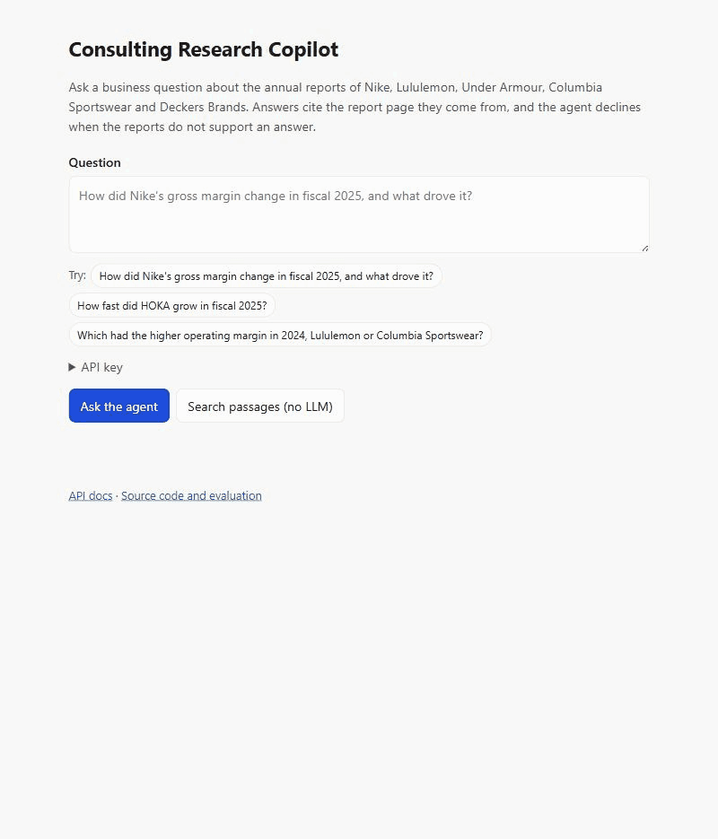
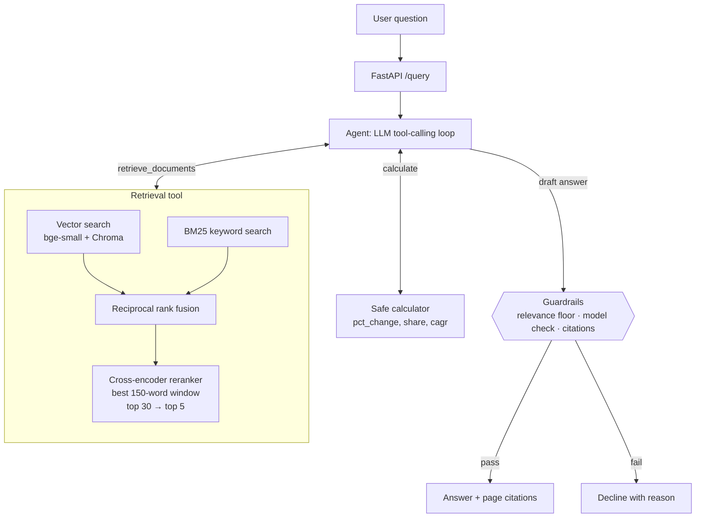

# Consulting Research Copilot

[](https://github.com/Ohm-Kel/consulting-research-copilot/actions/workflows/ci.yml)


Question answering over five companies' annual reports, with page-level citations, a
calculator-equipped agent that declines when the reports are silent, and an evaluation that CI
re-runs on every change.

## Demo



*The demo page running locally with `gpt-5.6-luna`: answered in 14 seconds with page citations.
There is no hosted copy ([ADR 0013](docs/adr/0013-no-hosted-demo.md)); more real answers are in
[docs/examples.md](docs/examples.md).*

## Problem and solution

In the first days of a project, a consulting case team reads hundreds of pages of annual reports
to answer questions such as how margins moved and why. A general chatbot answers fluently, but it
cites nothing and guesses when the documents are silent.

The copilot answers from the reports of Nike, Lululemon, Under Armour, Columbia Sportswear and
Deckers Brands (about 500 pages). It finds the relevant passages and tables, works out figures
with a calculator, cites the page behind every claim, and declines when the reports do not
support an answer.

## Features

- **Page-level citations** on every answer.
- **Hybrid retrieval:** keyword (BM25) and vector search, fused and reranked by a cross-encoder
  that scores each passage by its best 150-word window.
- **Tool-calling agent** that searches again when results are weak and uses a safe calculator
  for growth rates, shares and CAGR.
- **Guardrails** that decline when no passage clears a relevance floor set from measured scores,
  or when the model judges the evidence insufficient.
- **Evidence-level evaluation:** a development set, two never-tuned held-out sets and a
  cross-company comparison set, with confidence intervals. CI fails if retrieval quality drops.
- **Service:** FastAPI with a demo page, API-key auth, rate limits and a daily cap on paid
  questions, in a Docker image with the index built in.

## Architecture



Ingestion splits each PDF page into 300-word chunks that never cross a page, so every citation
points to one page. The agent loop is plain Python, with no agent framework. Each design choice,
with the options that were measured, is recorded in [docs/adr/](docs/adr/README.md); the API,
safety, observability and CI details are in [docs/engineering.md](docs/engineering.md).

## Tech stack

| Layer | Choice |
|---|---|
| LLM | OpenAI `gpt-5.6-luna` (app), `gpt-5.6-terra` (final evaluation answers), Responses API |
| Retrieval | `bge-small-en-v1.5` embeddings, Chroma, `rank_bm25`, `ms-marco-MiniLM-L-6-v2` reranker |
| Evaluation | Evidence-level retrieval metric with bootstrap intervals, RAGAS |
| Service | FastAPI, uvicorn, Docker |
| Tooling | Python 3.12, uv, Ruff, mypy, pytest, pre-commit, GitHub Actions |

## Getting started

You need [uv](https://docs.astral.sh/uv/getting-started/installation/), which installs Python
3.12 if it is missing, and about 2 GB of disk. Everything runs on a laptop CPU.

```powershell
git clone https://github.com/Ohm-Kel/consulting-research-copilot.git
cd consulting-research-copilot
uv sync                                   # the exact versions in uv.lock
uv run python scripts/download_data.py    # the five reports, checksum-verified
uv run copilot ingest                     # build the index (a few minutes)
```

Search, the tests and the free evaluations need no API key. For the agent, copy `.env.example`
to `.env` and set `OPENAI_API_KEY`; every other setting is optional and documented there and in
[`src/copilot/config.py`](src/copilot/config.py).

```powershell
uv run uvicorn copilot.api:app --port 8000   # demo page at http://localhost:8000/, API docs at /docs
uv run pytest --cov                          # tests; fails below 93% coverage
uv run pre-commit run --all-files            # Ruff lint and format, mypy
```

## Usage examples

```powershell
uv run copilot search "How fast did HOKA grow?"                             # retrieval only, free
uv run copilot agent "How much did Nike's net income fall in fiscal 2025?"
```

```powershell
Invoke-RestMethod -Method Post http://localhost:8000/query -ContentType "application/json" `
  -Body '{"question": "How much did Nike spend on demand creation in fiscal 2025?"}'
```

`POST /search` takes the same body, plus an optional `"k"`, and never calls the LLM.

## Evaluation results

| | Development (25) | Held-out (20) | Harder held-out (20) | Comparisons (7) |
|---|---|---|---|---|
| Answer evidence in the top 5 (vector baseline) | **88%** (60%) | **90%** (95%) | **90%** (80%) | **43%** from both reports (0%) |
| Agent answers citing a supporting page | 24 / 25 | 20 / 20 | 20 / 20 | 7 / 7 from both reports |
| Calculations correct | 4 / 4 | 5 / 5 | 6 / 6 | |
| Faithfulness (RAGAS, independent judge) | 0.91 | 0.93 | | |
| Out-of-scope questions declined | 8 / 8 | | | |

- Settings were chosen on the development set only. The held-out and comparison sets were
  written afterwards and are never tuned on.
- On the development set the pipeline beats vector search by 28 points (95% CI +4 to +52). On
  the held-out sets it finds as much as plain hybrid search but does not rank answers higher.
- Two answer keys listed one wording per fact and were corrected after a full audit against the
  reports; both corrections, and the scores before them, are reported.

Methods, every table and the lessons learned: [docs/evaluation.md](docs/evaluation.md).

## Project structure

```
src/copilot/   the package: ingestion, retrieval, agent and tools, metrics, API, CLI
tests/         pytest suite; the LLM is replaced by a scripted fake
evals/         question sets, evaluation runners and results/
scripts/       report download with checksums, example generation
notebooks/     the first learning scripts (stage 0)
docs/          evaluation write-up, ADRs, examples, demo GIF
```

## Roadmap

- **Known limits:** 7 of 65 single-report questions still miss the top 5, mostly figures in
  tables or dense highlight lists. Tables are flattened to text, search takes about 7 seconds on
  a laptop CPU, the question sets are small, and there is no hosted demo.
- **Next:** table-aware extraction, more held-out questions, and a larger comparison set.
- **History:** [CHANGELOG.md](CHANGELOG.md).

## Contributors and roles

- **Semanu Kwaku Sebuava** ([@Ohm-Kel](https://github.com/Ohm-Kel)): design, implementation and
  evaluation.

Contributions are welcome; see [CONTRIBUTING.md](CONTRIBUTING.md).

## License

Released under the [MIT License](LICENSE). Copyright (c) 2026 Semanu Kwaku Sebuava.
